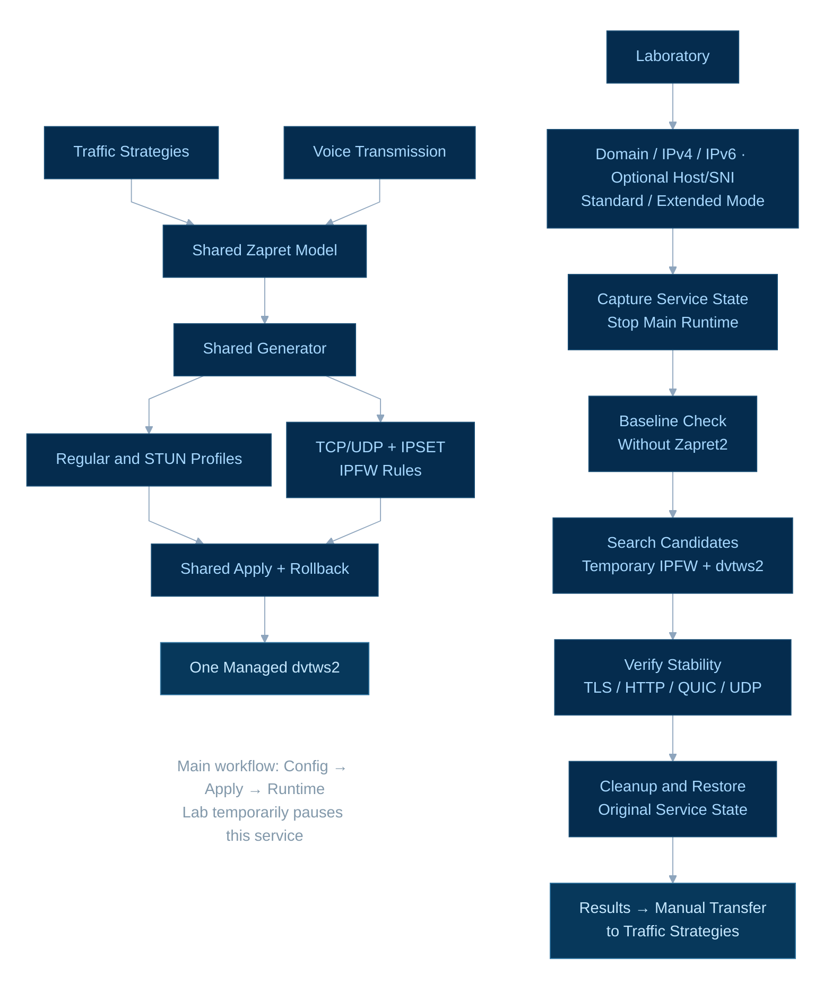
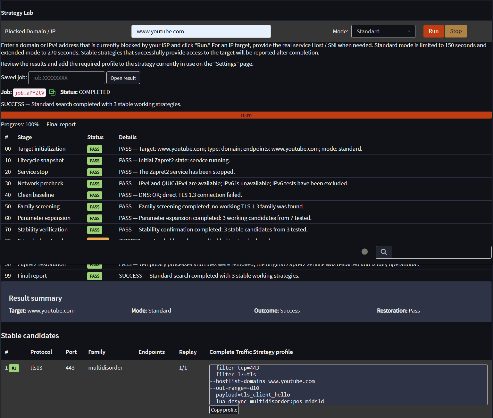

# os-zapret2-restyle

[](https://github.com/Tolian82/os-zapret2-restyle/releases/latest)
[](https://github.com/Tolian82/os-zapret2-restyle/actions/workflows/ci.yml)
[](LICENSE)

> [!IMPORTANT]
> This project and its documentation are provided for scientific, technical, and educational purposes only.
> Using these materials for purposes other than research, review, or learning may violate applicable laws and regulations.
> Users are responsible for ensuring that their use complies with applicable law. The authors do not endorse or accept responsibility for unlawful use or misuse of these materials.

> [!TIP]
> Native OPNsense plugin for **bol-van/zapret2**: manage the runtime, build DPI-bypass profiles, and automatically search for strategies that actually work from your firewall.

[](https://github.com/Tolian82/os-zapret2-restyle)

> [!WARNING]
> ⭐ **Like this project?** [Give it a star on GitHub](https://github.com/Tolian82/os-zapret2-restyle) — it helps others discover os-zapret2-restyle.
>
> ⭐ **Понравился проект?** [Поставьте звёздочку на GitHub](https://github.com/Tolian82/os-zapret2-restyle) — это поможет другим пользователям найти os-zapret2-restyle.

| Project | Current release |
|---|---|
| **Latest full Web/pkg release** | [v0.6.2](https://github.com/Tolian82/os-zapret2-restyle/releases/tag/v0.6.2) — verified FreeBSD 15 `0.6.2_1.pkg`, `SHA256SUMS` and successful GitHub Pages pkg repository deployment. |
| **Latest owner-installed testing package** | [v0.6.1_30](https://github.com/Tolian82/os-zapret2-restyle/releases/tag/v0.6.1_30) — 18/18 read-only appliance checks passed, including running service, eight global Exclude bindings and no stale Lab firewall rules. |
| **Current development candidate** | `v0.6.2_2` source-only publication record; **no `0.6.2_2.pkg` exists**. The installed release artifact remains `v0.6.2` / `0.6.2_1.pkg`. |
| **Target platform** | OPNsense 26.7 · FreeBSD 15 amd64 |
| **Runtime** | bol-van/zapret2 (`dvtws2`) |
| **OPNsense service** | `zapret` |
| **License** | MIT |

`os-zapret2-restyle` integrates the [bol-van/zapret2](https://github.com/bol-van/zapret2) native `dvtws2` engine with OPNsense: transactional Traffic Strategies, automatic Strategy Lab testing, upstream runtime management and a configurable Voice Transmission page. The plugin and upstream Zapret2 engine have separate installation/update lifecycles.

**Verification limits:** the owner observed a successful `v0.6.1_30` Standard Strategy Lab IPv4 run (three stable TLS 1.3 candidates, Stage85/90/99 and restoration), and a subsequent read-only appliance audit passed **18 checks with zero warnings/errors**: eight effective global IP exclusions, shared `dvtws2` runtime, three owned IPFW rules, no stale Lab rules. Separate native FreeBSD 15.1 CI qualified three real IPv6 cases. The owner's OPNsense stand lacks IPv6; live IPv6 WAN testing was explicitly waived, **not passed**. These results do not establish actual ISP-side DPI bypass, packet-level installed A07/A08 or successful voice calls. Results prove the observed scenarios, not every possible DPI/ISP/QUIC bypass. The five Voice/STUN profiles are configurable, but **no successful Telegram media/call bypass has been confirmed on the owner's direct ISP route**; other services likewise have no validated voice presets. See [Strategy Lab evidence](docs/verification/evidence/2026-10-22-v0.5.6_17-stage6-installed-hygiene.md) and [Voice research closure](docs/verification/evidence/2026-10-20-telegram-native-voice-provider-blocked-final-closure.md).

**Full-release verification boundary:** The [v0.6.2 stable GitHub Release](https://github.com/Tolian82/os-zapret2-restyle/releases/tag/v0.6.2) published the exact FreeBSD 15 `0.6.2_1.pkg` and SHA256SUMS; the [release workflow](https://github.com/Tolian82/os-zapret2-restyle/actions/runs/41207085714) verified package repository generation and successful GitHub Pages deployment for `FreeBSD:15:amd64`. An independent public Pages HTTP fetch was unavailable in the verification environment, and the owner's Web GUI upgrade, real IPv6 WAN traffic, installed WAN Exclude effects and Voice MEDIA/CALL are not inferred. [Current release preparation](docs/releases/v0.6.2.md) · [Dual-stack specification](docs/architecture/ZAPRET2_EXCLUDE_IPSET_SPEC.md).

## Architecture overview



## Strategy Lab — find a working bypass strategy instead of guessing

**Strategy Lab is a major feature of the project.** Give it a target domain, IPv4 or IPv6 address and it evaluates real Zapret2 strategy families on the OPNsense firewall, checks stability, and returns verified candidates for **manual** use in Traffic Strategy. It cannot guarantee a working bypass on every ISP or target.



*Screenshot: a completed Strategy Lab run with three verified candidates and successful restoration of the original Zapret2 service. Results are specific to the tested ISP and target.*

The Laboratory is designed around one practical question:

> **Which Zapret2 strategy actually works for this target, on this ISP, from this exact OPNsense installation?**

What it does:

- accepts a blocked **domain, IPv4 address or IPv6 literal** (IPv6 targets require the Lab IPv6 checkbox);
- supports optional **Host / SNI** for fixed-IP HTTPS/TLS/QUIC testing;
- measures direct reachability with private [curl-impersonate](https://github.com/lexiforest/curl-impersonate) Chrome-compatible TLS/HTTP/HTTP/3 probing with ECH disabled for consistent accessibility checks (not a browser ECH-on compatibility test) before trying bypass candidates; direct accessible targets are not reported as needing bypass;
- runs deterministic native Zapret2 strategy candidates with temporary runtime and firewall rules;
- attributes candidate traffic to exact controlled source ports and temporary firewall rules;
- checks stability, maintains at most three confirmed finalists, and replays selected profiles before recommending them;
- counts a verified TLS or QUIC handshake **or** an authentic final HTTP response (including 4xx/5xx) as endpoint reachability; preserves the distinction between target identity, transport evidence and successful bypass;
- supports **Extended** protocol checks for TLS 1.2, HTTP, QUIC and optional Generic UDP;
- treats bare-IP QUIC truthfully: without Host/SNI it is skipped rather than reported as tested;
- can test Generic UDP independently against eligible pinned endpoints, with family-specific support and explicit unavailable outcomes;
- emits complete final profiles, including `--ipset-ip=<target>` for fixed-IP strategies;
- supports Russian and English UI/status presentation, saved-job read-only lookup by Job ID, F5 persistence of selected saved results and an inline Job ID copy control;
- supports temporary, explicitly started browser circular validation for eligible verified TLS 1.3 candidates; it can affect other LAN clients while active and automatically stops/restores service state;
- includes bounded cleanup and restoration of original Zapret2 service state after success, failure or cancellation, with restoration errors reported rather than hidden.

**IPv6 in Strategy Lab:** The checkbox under **Mode / Режим** is OFF by default. OFF runs IPv4-only checks even if a domain has AAAA records; ON adds eligible routed IPv6 endpoints, including AAAA-only names and IPv6 literals. The one-job limits are **Standard 150 s (single family) / 200 s (eligible dual family)** and **Extended 270 s / 350 s**. Merely selecting IPv6 cannot extend the deadline without actual eligible A+AAAA and IPv6 connectivity. IPv6-only QUIC is explicitly skipped when its dedicated helper cannot test it; never treat a skipped probe as success. The available native FreeBSD 15.1 IPv6 evidence is not a substitute for owner WAN acceptance.

A result reflects the selected measured path rather than a speculative recommendation. A candidate is not a proven winner without its required verification and replay. QUIC/HTTP/3 availability at one endpoint does not establish bypass on a blocked service.

## Native OPNsense integration

- OPNsense MVC/API/configd integration rather than an external control panel.
- Start/stop/status management for Zapret2.
- Managed supervisor ownership and `ipfw` divert rules.
- Transactional configuration changes with health verification.
- State-preserving package upgrades: a running service returns running; a stopped service stays stopped.
- Runtime checks validate the complete managed state instead of only one process.

## Traffic Strategy editor

The **Strategies / Стратегия** Settings page provides one multiline editor using native Zapret2 syntax plus project-managed target placeholders:

```text
<HOSTLIST:name>
<IPSET:name>
```

Profiles are separated with the normal Zapret2 boundary:

```text
--new
```

The backend expands managed targets while preserving the rest of the user-authored Zapret2 profile. Apply is transactional: invalid or unhealthy candidate configuration does not silently replace a working runtime. The **upper Apply** in the Zapret2 Service panel installs or changes the selected *upstream Zapret2 release*; the **lower Apply** saves and activates *Traffic Strategies*. They are separate operations and are serialized for safety.

## Global Exclude IPSet and dual-stack targets

**Traffic Strategies → Exclude IPSet** is directly below **Exclude Domains** in both normal and Advanced views. Enter IPv4 or IPv6 addresses/CIDRs (one per line); nested, overlapping and adjacent blocks are canonicalized without changing the represented addresses. The plugin compiles one managed exclusion set and injects `--ipset-exclude` into every executable ordinary Strategy and Voice profile, including profiles assembled with `--new`, templates/imports and installed extra resources. **Exclude Domains** remains domain-only and is not applied to Voice/STUN or converted into IP addresses.

Managed IPSET targets (including all five Voice destination lists) accept IPv4/IPv6. Every user-managed include/exclude/Voice IP list rejects `0.0.0.0/0`, `::/0` and equivalent full-family coverage such as two complementary `/1` networks. Global address exclusions are destination-based, not a guarantee that an ISP's blocking policy is bypassed. The installed audit confirms correct profile attachment and valid saved state; only separate native FreeBSD 15.1 traffic tests have qualified real IPv4/IPv6 Exclude behavior. Actual per-packet WAN exclusion on the installed gateway remains unverified.

[Detailed IPv4/IPv6 and Exclude specification](docs/architecture/ZAPRET2_EXCLUDE_IPSET_SPEC.md).

## Additional Resources — installed Lua/BIN help

os-zapret2-restyle offers **optional installation and use of an expanded, integrity-verified Lua/BIN resource pack** from [Tolian82/zapret2-extra-resources](https://github.com/Tolian82/zapret2-extra-resources). **Install Additional Resources / Установить дополнительные ресурсы** on the Strategies page is a manual action: it checks the catalog and files, installs the optional resources, and uses the original native Zapret2 service restart and health verification. The pack is not installed automatically on page load, normal service start, plugin upgrade or upstream switch.

In the current plugin, **Remove Additional Resources / Удалить дополнительные ресурсы** appears directly below Install **only when Advanced mode is enabled**. After a fresh removal preview, it requires explicit confirmation of the exact resource count (`REMOVE N`). It removes all additional top-level Lua/BIN files **not tracked by the installed upstream Zapret2 Git HEAD**, including manually added files; it preserves the upstream-tracked files and saved Strategies/Voice settings. The native transaction checks current saved configuration, temporarily quarantines the additional files, then uses the existing combined Strategies+Voice Apply/Start path and verifies that Zapret2 is running correctly with standard files only. On a proven failure it restores the original files and previous working service; if restoration cannot be verified, it reports a recovery-required failure instead of claiming success. **Review the planned count and your own custom Lua/BIN files before confirming; removal is not an ordinary hide/disable operation.**

With **Full Help / Справка** enabled, the installed files appear in two cached columns: `.lua` on the left and `.bin` on the right. **Green** identifies resources tracked in the installed upstream Git HEAD, and **blue** identifies other installed files (including optional extras). The GUI reads an atomically published local JSON cache; it does not scan GitHub or Git on each Help view. After removal the Help area shows the not-installed/install explanation, and a new Strategy Lab Job uses the currently installed resource set. The owner confirmed the columns, colors and Help persistence after F5 on installed testing `v0.5.9_47`.

**Verification means catalog integrity, file provenance, guarded native integration, and the specific observed runtime/GUI tests.** It does **not** prove that every Lua script or BIN payload bypasses DPI, that all strategy/resource combinations interoperate, or that Telegram or other Voice calls succeed. The existing saved configuration is not automatically rewritten or Applied by installing extra resources. [Acceptance details and unrun-case limits](docs/verification/evidence/2026-10-27-v0.5.9_47-stage11-owner-final-acceptance.md).

## Voice Transmission — shared native runtime

The **Services → Zapret2 → Voice Transmission / Передача голоса** page is a native editor for five independent, initially disabled STUN profiles: **Telegram, Discord, X (Twitter), SIP (VoIP), and Custom**. It is not a separate daemon, VPN, proxy, or a library of proven call-bypass presets.

- Each service has an enable checkbox, editable multiline native `dvtws2` STUN/UDP parameters, and one named destination IPv4/IPv6 IPSET. Its text and addresses remain saved when disabled.
- Telegram shares the existing `hostlist.telegramips` dataset with Traffic Strategy; the other named IPSETs are also available to ordinary strategies.
- **Validate** checks a detached configuration without installing it. **Save inactive draft** persists an all-OFF configuration without activating it. **Apply** validates, saves and activates ON/OFF profiles through the *same* Config/FD9/runtime/IPFW transaction as Traffic Strategy.
- Enabled Voice profiles precede ordinary strategies in one `dvtws2` runtime. UDP capture is limited to selected destination IPSETs, ports and compatible WAN settings; `--filter-udp=*` does not create an unrestricted all-destination firewall rule.
- The page shows the shared service state and observable per-profile configuration, IPFW rules and counters. Per-profile status remains beneath its checkbox with help on or off; the three navigation labels localize correctly in Russian on regular page loads. Both GUI corrections were confirmed on the installed test package. These observations do **not** establish packet-level STUN success, bidirectional media or a working call.
- When Apply or draft-save has an **uncertain** result, reload the page and inspect current configuration/runtime before attempting another change. Do not assume a browser timeout means nothing changed.

**Current verification boundary:** Voice GUI/Config, shared Apply and managed IPFW outbound interception have been verified at their stated evidence levels. Telegram media/call through the owner's direct-provider OPNsense path **did not pass**, and this research campaign was explicitly closed. The previous pfSense direct-reflector `MEDIA_PASS` was on an OpenVPN-routed Telegram subnet, not the same ISP path; no validated Telegram bypass preset is claimed. Other Voice services remain independently unqualified for media, and the Squid/sing-box/SSH/routing lab is not managed by the plugin.

For details see the [current Voice specification](docs/architecture/VOICE_TRANSMISSION_GUI.md) and [completion gate](docs/VOICE_CODE_COMPLETION_GATE.md).

## Zapret2 Service manager

The GUI contains **Zapret2 Service / Служба Zapret2** for managing the upstream bol-van/zapret2 runtime independently from the OPNsense plugin package. It can:

- show the installed upstream release;
- show recent stable upstream releases;
- install Zapret2 for the first time;
- update, reinstall or downgrade to a selected release;
- preserve the previous running/stopped state;
- roll back if activation fails.

No OPNsense reboot is required after a successful managed operation.

## Installation from the OPNsense Web GUI

Full releases are published through the project-owned FreeBSD package repository on GitHub Pages. Register it once using the OPNsense **root shell**:

```sh
fetch -o /usr/local/etc/pkg/repos/zapret2-restyle.conf \
  https://tolian82.github.io/os-zapret2-restyle/zapret2-restyle.conf
pkg update -f
```

Then open **System → Firmware → Plugins** and install **`os-zapret2-restyle`**.

The repository is transported over HTTPS and uses the project-approved unsigned pkg configuration `signature_type: "none"`.

## First setup

1. Open **Services → Zapret2 → Settings**.
2. Open **Zapret2 Service / Служба Zapret2** and install/select an upstream bol-van/zapret2 release.
3. Configure your managed targets and **Traffic Strategy**.
4. Apply the settings.
5. Optionally open **Services → Zapret2 → Voice Transmission** to configure destination-restricted STUN/UDP services; all profiles are OFF until explicitly enabled and applied.
6. Open **Services → Zapret2 → Laboratory** when you need to find a working bypass strategy for a blocked target.
7. Review a stable Laboratory result and add the required profile to the Traffic Strategy currently in use.

The plugin package and the upstream bol-van/zapret2 runtime intentionally have separate lifecycles.

## Example Traffic Strategy

```text
--filter-tcp=80
<HOSTLIST:user>
--filter-l7=http
--payload=http_req
--lua-desync=fake:blob=http_iana_org:tcp_md5
--lua-desync=multisplit:pos=method+2

--new

--filter-tcp=443
<HOSTLIST:youtube>
--filter-l7=tls
--blob=tls7
--out-range=-d8
--payload=tls_client_hello
--lua-desync=multisplit:pos=2,midsld-2:seqovl=1:seqovl_pattern=tls7

--new

--filter-tcp=443
<IPSET:telegram>
--filter-l7=mtproto,unknown
--payload=mtproto_initial,unknown
--lua-desync=fake:blob=stun:repeats=6
```

### Managed domain targets

Enter one domain per line:

```text
youtube.com
*.youtube.com
```

### Managed IPv4/IPv6 targets

Enter one IPv4 address or CIDR network per line:

```text
149.154.160.1
149.154.160.0/20
```

IPv6 targets are accepted as single addresses or CIDR networks (for example, `2001:db8:1234::/48`) subject to the full-family exclusion policy above. The example prefix is documentation-only; use addresses assigned to your environment.

## Safe Apply and runtime lifecycle

Configuration activation follows a transactional path:

1. normalize and validate model input;
2. build candidate target files and runtime arguments;
3. validate the candidate configuration;
4. switch runtime state;
5. verify firewall/process health;
6. confirm the committed Config/runtime/firewall state; restore the prior state on a safely reversible failure, or **require inspection** when a native save/activation outcome is uncertain.

A failed or timed-out Apply does not automatically prove the original configuration is still active. The native worker and GUI distinguish pre-write rejection from states requiring explicit review.

Lifecycle operations are serialized. The plugin owns its PID/state files, supervisor state and temporary firewall rules so stale callbacks cannot tear down a replacement runtime.

## Upstream runtime management from shell

The Web GUI uses the same authoritative backend available to administrators:

```sh
# Install the latest stable upstream release.
/usr/local/opnsense/scripts/OPNsense/Zapret/setup.sh
/usr/local/opnsense/scripts/OPNsense/Zapret/setup.sh install

# Show recent stable upstream releases.
/usr/local/opnsense/scripts/OPNsense/Zapret/setup.sh show

# Install/reinstall/upgrade/downgrade to an exact release.
/usr/local/opnsense/scripts/OPNsense/Zapret/setup.sh install v1.0.3

# Help.
/usr/local/opnsense/scripts/OPNsense/Zapret/setup.sh --help
```

## Useful runtime paths

```text
/usr/local/etc/zapret2/lua/
/usr/local/etc/zapret2/files/fake/
/var/db/zapret2-restyle/runtime.release
/var/db/zapret2-restyle/releases.cache
/var/db/zapret2-restyle/setup.status
/var/run/zapret2-execution.status
/var/run/zapret2-restyle/strategy-lab/
/var/log/zapret2/strategy-lab/
/var/log/zapret2/dvtws2.log
/var/log/zapret2/supervisor.log
```

The two Zapret2 resource directories above hold both installed upstream-tracked files and optional additional resources; the Lua/BIN Help and removal plan distinguish their provenance using the local upstream Git HEAD.

The managed `dvtws2` process drops privileges to UID/GID `65534`; managed Lua/BLOB files and runtime directories are normalized to permissions appropriate for that boundary.

## Removal policy

Removing the plugin stops its managed service before package files disappear. Saved OPNsense configuration, downloaded upstream runtime, setup/runtime logs and shared dependencies are preserved for later reinstall or investigation.

## Release model

| Type | Meaning |
|---|---|
| **Testing package** | Persistent GitHub `.pkg` used for owner-assisted development/live verification. It does not automatically replace the Full Web/pkg release. |
| **Full Web/pkg release** | Verified package published through the project package repository and installable/upgradable from the OPNsense Web GUI. |

Version/product semantics are defined by `DEV-027` and the related version rules in [`docs/PROJECT_PRINCIPLES.md`](docs/PROJECT_PRINCIPLES.md). Testing/full-publication mechanics start at `GH-034` in [`docs/GITHUB_PUBLICATION.md`](docs/GITHUB_PUBLICATION.md). Those rule books are the normative source; this README only presents the user-facing release model.

## Documentation for contributors

Start with [`AGENTS.md`](AGENTS.md). It routes to the current handoff, state, rule books, roadmap and documentation index. The project keeps current state separate from historical evidence so development can continue without reconstructing old decisions from chat history.

The current verified stable publication is **[v0.6.2](https://github.com/Tolian82/os-zapret2-restyle/releases/tag/v0.6.2)** with `0.6.2_1.pkg`, checksum and FreeBSD15 Pages/pkg workflow completed. `v0.6.2_2` is a later documentation-only source revision, not another published package. Owner-installed evidence comes from `v0.6.1_30`; the owner has not yet confirmed `0.6.2_1` Web upgrade, real IPv6 WAN or Voice MEDIA/CALL. [Release preparation](docs/releases/v0.6.2.md) · [Current handoff](docs/START_HERE.md).

Useful entry points:

- [`docs/START_HERE.md`](docs/START_HERE.md)
- [`docs/PROJECT_STATE.md`](docs/PROJECT_STATE.md)
- [`docs/ROADMAP.md`](docs/ROADMAP.md)
- [`docs/INDEX.md`](docs/INDEX.md)
- [`Native Voice TNAS lab`](docs/architecture/TELEGRAM_NATIVE_VOICE_TNAS_LAB.md)
- [`docs/architecture/`](docs/architecture/)
- [`docs/verification/`](docs/verification/)

## Acknowledgements

This independent project builds on open-source work by **bol-van** and **Umur Gorur**, and uses the browser-compatible HTTP client from **[lexiforest/curl-impersonate](https://github.com/lexiforest/curl-impersonate)**. See [`CONTRIBUTORS.md`](CONTRIBUTORS.md) for project credits and [`NOTICE`](NOTICE) for copyright attribution.

## License

MIT. See [`LICENSE`](LICENSE), [`NOTICE`](NOTICE) and [`CONTRIBUTORS.md`](CONTRIBUTORS.md) for upstream attribution.
